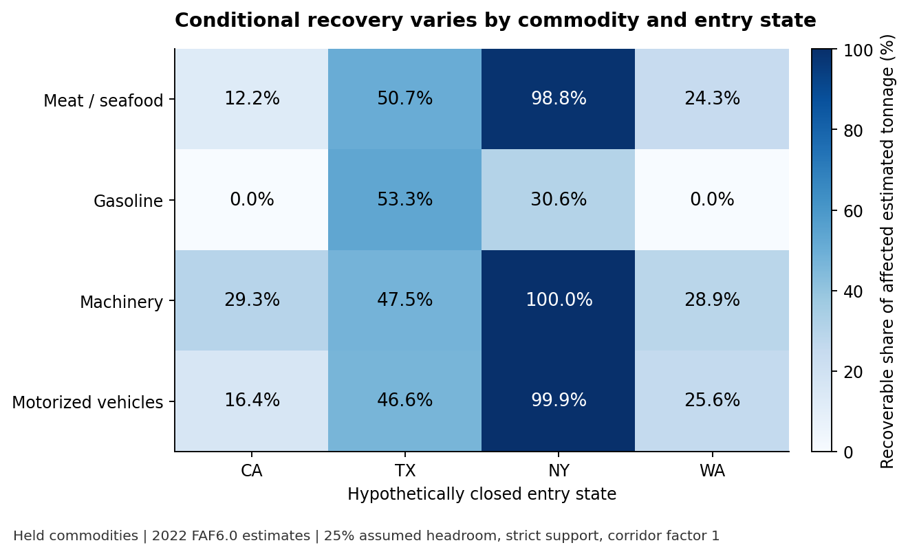

# Freight substitution: assumptions before operational commitments

**Decision:** use estimated-flow concentration to identify where operator evidence is needed before planning an entry-state substitution. FAF6.0 describes 2022 estimated freight; it does not report spare port, carrier or road capacity.

**Verified conditional finding:** all 512 fixed scenarios have exact feasible-flow and matching-cut certificates. With 25% assumed additional gateway headroom, strict published corridor support and corridor factor 1, recovery ranges from 0% to 100% across the 16 held commodity/entry-closure cases below. This range is a finite-model result. It is not a confidence interval, forecast or observed disruption outcome. All primary cases are retained.

**Action:** prioritize gathering actual entry-facility capacity, route feasibility, carrier commitments and disruption timing. Use the scenario lattice to record how those facts change the answer. Do not book transport or claim savings from these figures.

Every closure disables a state's **entry function**, not its inland destinations or all of its roads. Each commodity is solved separately, so the results do not establish simultaneous capacity for multiple commodities. An entry state represents the entire state, not a single port.

## All held primary cases

Tonnage columns are **thousand short tons** in the 2022 benchmark, rounded only for display. Recovery is a share of affected estimated tonnage. Exact rational values remain in results/held.csv. Optimization gain is relative to the fixed feasible greedy allocation under identical constraints. Decimal digits do not establish physical measurement precision.

| Commodity | Closed entry | Affected | Recovered | Unmet | Recovery | Optimization gain |
|---|---|---:|---:|---:|---:|---:|
| Meat/seafood | CA | 415.170 | 50.600 | 364.570 | 12.2% | 0.000 |
| Meat/seafood | TX | 55.364 | 28.074 | 27.290 | 50.7% | 0.000 |
| Meat/seafood | NY | 108.466 | 107.140 | 1.326 | 98.8% | 0.000 |
| Meat/seafood | WA | 126.732 | 30.755 | 95.977 | 24.3% | 0.000 |
| Gasoline | CA | 4,271.198 | 0.000 | 4,271.198 | 0.0% | 0.000 |
| Gasoline | TX | 628.892 | 335.501 | 293.391 | 53.3% | 0.000 |
| Gasoline | NY | 450.181 | 137.627 | 312.554 | 30.6% | 0.000 |
| Gasoline | WA | 257.180 | 0.000 | 257.180 | 0.0% | 0.000 |
| Machinery | CA | 4,181.086 | 1,226.016 | 2,955.069 | 29.3% | 14.227 |
| Machinery | TX | 778.736 | 369.655 | 409.081 | 47.5% | 0.000 |
| Machinery | NY | 100.588 | 100.588 | 0.000 | 100.0% | 0.000 |
| Machinery | WA | 861.181 | 248.642 | 612.539 | 28.9% | 0.000 |
| Motorized vehicles | CA | 6,222.386 | 1,020.410 | 5,201.976 | 16.4% | 14.418 |
| Motorized vehicles | TX | 357.348 | 166.521 | 190.827 | 46.6% | 0.000 |
| Motorized vehicles | NY | 16.878 | 16.855 | 0.023 | 99.9% | 0.000 |
| Motorized vehicles | WA | 892.154 | 228.810 | 663.344 | 25.6% | 0.015 |

## What the comparison establishes

The complete 256 held settings include both corridor factors, both support conventions and all four headroom factors. Exact optimization improves on the specified greedy allocation in 27 settings; it ties in 229. In the primary setting it improves 3 of 16 cases. The largest held gain anywhere in the declared lattice is 70.630 thousand short tons, a conditional allocation difference rather than realized benefit. No alternative policy search or optimal greedy-order claim was made.

Increasing declared capacities or allowing pooled support cannot reduce the finite-model optimum; 2,304 development/held monotonicity checks passed. Pooled support relaxes an assumption about substitutability. A positive feasible allocation does not prove a physical route or a carrier can serve it. Zero published support does not prove a real-world route is impossible.

## Evidence and limits

The 8,563 selected facts reconcile to the 599,529-row official archive; an independent CSV engine confirmed 102,756 selected scalar fields/locators. Twelve fixtures include reverse-flow reallocation, capacity sharing, fractional scaling, no-path/zero-flow and a greedy counterexample. Independent SQL/rational checks reconstruct every edge and verify capacity, conservation, exact optimality certificates and the deterministic baseline: 813,520 development and 934,029 held exact checks. The isolated replay matches 759,047 CSV/certificate fields. Seventeen canonical dependencies were publicly frozen before held analytical summaries; raw inputs and source-quality information were visible, without blinding. There was no fitting, parameter selection, prediction or statistical generalization test.

The source does not supply actual spare capacity, facility/road topology, timetable, shipping contracts, disruption behavior or uncertainty intervals. Capacity factors are hypothetical additions scaled to baseline estimated flows. The fixed origin/gateway multiplier is an illustrative 100% additional-flow cap. No capacity factor was empirically calibrated. Commodity/state choices are a fixed finite design, not a representative sample. Full source archives/workbooks, unrelated values and formal-publication projects remain outside the public repository. Sources and original implementation are documented in SOURCES.md; this independent manuscript is not peer reviewed and claims no scientific novelty.

## Reproduce and inspect

Run `python -m pip install -r requirements.txt`, `python -m unittest discover -s tests -v`, `python src/check_reproduction.py`, `python src/verify_figures.py`, `python src/verify_paper.py` and `python src/verify_public_package.py`. Read the [executable protocol](PROTOCOL.md), [source record](data/source/manifest.json), [freeze](FREEZE.json), [complete outputs](results), [independent checks](results/held-VERIFICATION.json) and [manuscript](paper/manuscript.pdf). The public snapshot excludes the original archive; the raw reconciliation receipt records the completed source check. CI rechecks the selected snapshot rather than silently downloading a newer release.
